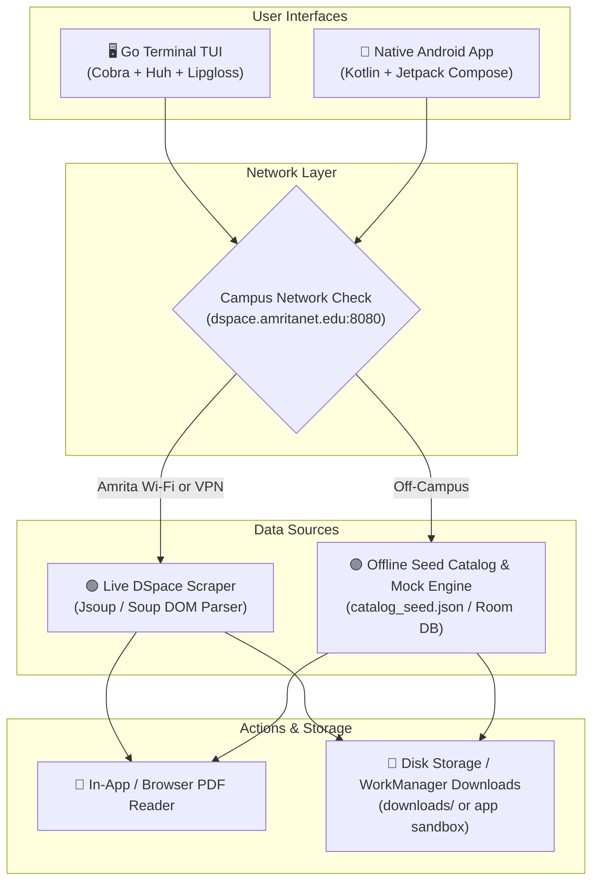

<div align="center">

  

  # ⚡ AMRITA PYQ FETCHER & SUITE ⚡
  
  <p align="center">
    <b>The Complete Previous Year Question Paper (PYQ) Retrieval Suite for Amrita University — featuring a powerful Desktop Terminal TUI and a modern Native Android App.</b>
  </p>

  <!-- Badges Shelf -->
  <p align="center">
    <a href="https://github.com/pkpranav-projects/Amrita-PYQ-Fetcher/releases/latest"></a>
    <a href="https://github.com/pkpranav-projects/Amrita-PYQ-Fetcher/releases"></a>
    <a href="https://pkpranav-projects.github.io/Amrita-PYQ-Fetcher/"></a>
    
    
    
    <a href="LICENSE"></a>
  </p>

  <p align="center">
    <a href="#-overview"><b>Overview</b></a> •
    <a href="#-android-application-features"><b>Android App</b></a> •
    <a href="#-terminal-tui-features"><b>Terminal TUI</b></a> •
    <a href="#-downloads--releases"><b>Downloads</b></a> •
    <a href="#-campus-network--offline-demo-mode"><b>Network Modes</b></a> •
    <a href="#%EF%B8%8F-architecture--tech-stack"><b>Architecture & Tech Stack</b></a> •
    <a href="#-running-from-source"><b>Build Instructions</b></a>
  </p>

</div>

---

## 📖 Overview

Amrita Vishwa Vidyapeetham archives its official semester and mid-term examination question papers within its internal **DSpace Digital Repository** (`dspace.amritanet.edu:8080`). Navigating this repository through traditional web browsers is often slow, cumbersome, and restrictive.

**AMRITA PYQ FETCHER & SUITE** solves this problem by delivering a complete, dual-interface ecosystem:
1. 📱 **Native Android Application (`android/`)**: A sleek, modern Jetpack Compose mobile app engineered with Material 3, frosted-glass aesthetics, built-in PDF viewer, biometric authentication, WorkManager bulk downloading, and a 161+ verified paper offline seed catalog.
2. 🖥️ **Terminal TUI & CLI (`cmd/`)**: An interactive, keyboard-driven terminal application built with Go, Charmbracelet `huh` and `lipgloss`, offering 1-click past 5-year pack downloads, fuzzy search, and in-browser viewing across Windows, macOS, and Linux.

---

## 📱 Android Application Features

The native Android app brings the power of PYQ retrieval into your pocket with an industry-grade, clean-architecture Kotlin codebase:

* 🎨 **Jetpack Compose & Material 3 with Frosted-Glass Aesthetics**: Built with the latest Compose BOM, featuring dynamic color theming, fluid transitions, and backdrop blur (`Haze`) for translucent app bars and dialogs.
* ⚡ **Pre-Seeded Offline Catalog (161+ Verified Papers)**: Ships with `catalog_seed.json` generated directly from Amrita curriculum records, featuring 161 verified bitstream download paths with zero artificial synthesis.
* 📄 **Built-in High-Performance PDF Reader**: Open and review exam papers directly inside the app with full pan, pinch-to-zoom, and rapid page jumping (`PdfDoc` & `ReaderScreen`).
* 🔒 **Biometric Security & App Lock**: Protect your exam materials with optional fingerprint or face unlock using `androidx.biometric`.
* 📥 **Background Bulk Downloader**: Utilizes Android's `WorkManager` to reliably download whole semesters or 2-year subject packs in the background with persistent status notifications.
* 🌐 **Live DSpace Integration & Cleartext Network Security**: Configured with strict network security policies (`network_security_config.xml`) to communicate directly with internal campus endpoints (`dspace.amritanet.edu` and `172.17.18.57`).
* 🧪 **Offline Demo PDF Generator**: When you are off-campus without VPN access, the built-in generator produces structured mock exam PDFs so you can practice workflows and UI features anytime.
* 🏛️ **Modern MVVM + Clean Architecture**:
  * **Hilt (Dagger)** for modular dependency injection.
  * **Room Database & DAOs** for local indexing, offline caching, and instant paper search.
  * **Preferences DataStore** for persistent settings and download history.
  * **OkHttp 4 & Jsoup** for resilient web scraping and PDF stream handling.

```
android/
├── app/
│   ├── src/main/java/com/amrita/pyqfetcher/
│   │   ├── core/         # App state, biometric lock, sync managers, config
│   │   ├── data/         # Room DB, DAOs, DSpace scrapers, OkHttp clients, Demo PDF gen
│   │   ├── di/           # Hilt Dagger modules
│   │   ├── domain/       # Search engine and domain models
│   │   ├── ui/           # Jetpack Compose screens (Home, Subject, Library, Reader, More)
│   │   └── work/         # WorkManager bulk download workers
│   └── src/main/assets/  # catalog_seed.json (161 verified bitstream paths)
└── tools/                # Python scripts for catalog seed generation
```

---

## 🖥️ Terminal TUI Features

The Go terminal interface is built for speed and keyboard efficiency:

* ⚡ **Easy Mode (Fast Past 5-Year Pack Downloader)**: Select your Semester and Subject to instantly download all Mid-Term (P1, P2) and End-Semester papers across the past 5 years in 1-click, or choose separated **2-year ranges** (`2025–2026`, `2023–2024`, `2021–2022`, `2019–2020`).
* 🛡️ **Curriculum & Branch Navigation**:
  * **Cyber Security (B.Tech CYS)**: Full 2024 syllabus course catalog with official Amrita course codes (e.g., *19CYS202 - Cryptography and Network Security*).
  * **Computer Science (CSE)**, **Electronics (ECE)**, **Artificial Intelligence (AIE)**, **Electrical (EEE)**, **Mechanical (MECH)**, **MCA**, and **M.Tech**.
* 🔍 **Instant Fuzzy Search (`/`)**: Press `/` in any menu to immediately filter subjects, branches, or exam papers.
* 🌐 **Direct Browser Streaming**: Launches question papers directly in your default browser (Chrome, Edge, Brave, Firefox) using native OS protocol handlers.
* 📁 **Structured Disk Storage**: Organizes downloaded files cleanly under `downloads/<BRANCH>/<COURSE>/<YEAR_RANGE>/`.
* ⬅️ **Stack-Based Breadcrumb Navigation**: Seamlessly navigate back using `Esc` or `Back` without losing your place.

---

## 📦 Downloads & Releases

Pre-compiled, ready-to-install releases are available for Android, Windows, Linux, and macOS.

| Platform | Architecture / Target | Download Package | Quick Launch / Install |
|:---|:---:|:---|:---|
| 📱 **Android** | Universal APK (ARM64 / ARMv7 / x86) | [**`amrita-pyq-v2.0.0-android.apk`**](https://github.com/pkpranav-projects/Amrita-PYQ-Fetcher/releases/download/v2.0.0/amrita-pyq-v2.0.0-android.apk) | Download & tap to install |
| 🪟 **Windows** | x86_64 / amd64 | [**`amrita-pyq-v2.0.0-windows-amd64.zip`**](https://github.com/pkpranav-projects/Amrita-PYQ-Fetcher/releases/download/v2.0.0/amrita-pyq-v2.0.0-windows-amd64.zip) | Extract and double-click `run.bat` |
| 🐧 **Linux** | x86_64 / amd64 | [**`amrita-pyq-v2.0.0-linux-amd64.tar.gz`**](https://github.com/pkpranav-projects/Amrita-PYQ-Fetcher/releases/download/v2.0.0/amrita-pyq-v2.0.0-linux-amd64.tar.gz) | `tar -xzf ...` & `./amrita-pyq` |
| 🍎 **macOS** | Apple Silicon (M1–M4) | [**`amrita-pyq-v2.0.0-darwin-arm64.tar.gz`**](https://github.com/pkpranav-projects/Amrita-PYQ-Fetcher/releases/download/v2.0.0/amrita-pyq-v2.0.0-darwin-arm64.tar.gz) | `tar -xzf ...` & `./amrita-pyq` |
| 🍎 **macOS** | Intel x86_64 | [**`amrita-pyq-v2.0.0-darwin-amd64.tar.gz`**](https://github.com/pkpranav-projects/Amrita-PYQ-Fetcher/releases/download/v2.0.0/amrita-pyq-v2.0.0-darwin-amd64.tar.gz) | `tar -xzf ...` & `./amrita-pyq` |

👉 View all releases and notes on the [**GitHub Releases Page**](https://github.com/pkpranav-projects/Amrita-PYQ-Fetcher/releases).

---

## 📶 Campus Network & Offline Demo Mode

Because `dspace.amritanet.edu` is hosted on Amrita's private internal intranet, fetching live papers requires connection to the university network:

| Environment | Connection Mode | Status | Capabilities |
|:---|:---|:---:|:---|
| **At Campus** | Connected to **Amrita Wi-Fi** | 🟢 Live | Direct live fetching, streaming & downloading from university archives. |
| **At Home with VPN** | Connected to **Amrita GlobalProtect VPN** | 🟢 Live | Full access to real-time papers from anywhere in the world. |
| **Off-Campus / Mobile** | Regular Internet | 🟣 Demo / Seed Mode | Explore pre-seeded offline catalogs, test search filters, and generate mock PDFs. |

---

## 🏗️ Architecture & Tech Stack



### Tech Stack Matrix

| Layer | Terminal (Go) | Android (Kotlin) |
|:---|:---|:---|
| **Language** | Go 1.22+ | Kotlin 2.1+ (JVM 17) |
| **UI Framework** | Charmbracelet `huh` & `lipgloss` | Jetpack Compose (Material 3) |
| **Navigation** | Stack-based state machine | Navigation Compose (`androidx.navigation`) |
| **Local Storage** | File system downloads | Room Database + Preferences DataStore |
| **Networking** | Go `net/http` + `anaskhan96/soup` | OkHttp 4.12 + Jsoup 1.21 |
| **Background Tasks** | Go Goroutines | Android WorkManager 2.10 |
| **Security** | OS-level credential manager | BiometricPrompt API (`androidx.biometric`) |
| **PDF Handling** | Native OS system openers | Built-in PDF renderer & canvas view |

---

## 🚀 Running from Source

### 1. Terminal TUI (Go)

```bash
# Clone the repository
git clone https://github.com/pkpranav-projects/Amrita-PYQ-Fetcher.git
cd Amrita-PYQ-Fetcher

# Run directly
go run main.go

# Build production binary
go build -ldflags="-s -w" -o amrita-pyq.exe main.go
```

### 2. Android Application (Kotlin)

**Prerequisites:** JDK 17+ and Android SDK 36.

```bash
cd android

# Run unit tests
./gradlew testDebugUnitTest

# Build debug APK
./gradlew assembleDebug

# Install on a connected physical device or emulator
./gradlew installDebug
```

> [!NOTE]
> On Windows, if Gradle encounters a loopback connection issue, specify a space-free directory in `JAVA_TOOL_OPTIONS`:
> `JAVA_TOOL_OPTIONS="-Djdk.net.unixdomain.tmpdir=C:/jtmp -Djava.io.tmpdir=C:/jtmp"`

---

## ⌨️ Terminal Shortcuts

| Key | Action |
|:---:|:---|
| **`↑` / `k`** | Move cursor up |
| **`↓` / `j`** | Move cursor down |
| **`Enter`** | Confirm selection |
| **`/`** | Activate instant fuzzy search filter |
| **`Esc` / `Back`** | Return to previous menu level |
| **`Quit`** | Exit cleanly |

---

## 👨‍💻 Author & Maintainer

**P K Pranav**  
* GitHub: [@pkpranav-projects](https://github.com/pkpranav-projects)  
* Email: [pk.pranav7685@gmail.com](mailto:pk.pranav7685@gmail.com)  
* Repository: [Amrita-PYQ-Fetcher](https://github.com/pkpranav-projects/Amrita-PYQ-Fetcher)

*Original base project by Amrita CSE-25 community.*

---

## 📄 License

This project is licensed under the [MIT License](LICENSE).
